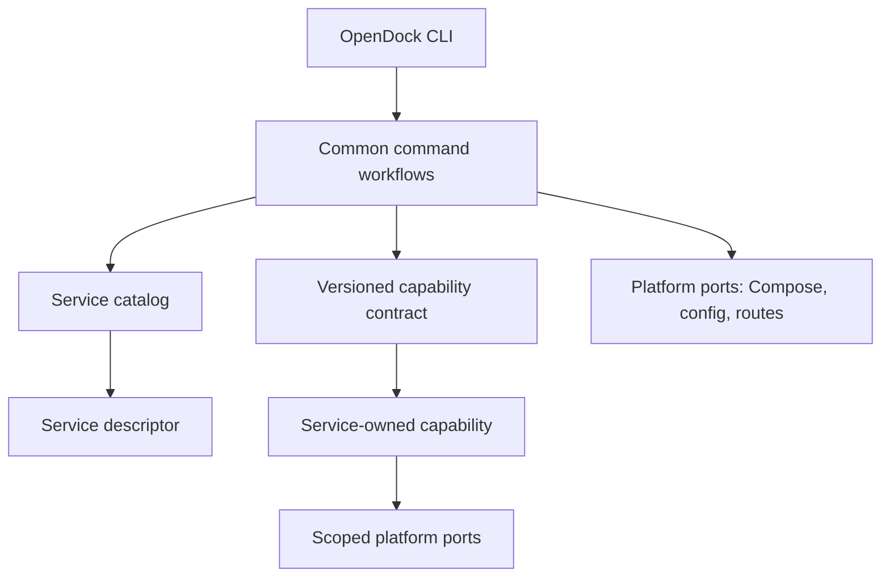

# OpenDock Command and Service Ownership

This document defines which behavior belongs to the common OpenDock CLI and
which behavior belongs to an individual service. The goal is to keep the user
command surface consistent while allowing new services to add their own setup,
launch, and removal behavior without growing service-specific branches in the
CLI dispatcher.

## Design rule

The CLI owns **workflow orchestration and shared platform behavior**. A service
owns **knowledge and operations that are unique to that service**.

For example, `./opendock launch hermes` remains a common command. OpenDock
resolves the target, checks configuration, starts shared prerequisites, calls
Hermes' declared first-run preparation when needed, starts the Compose project,
and applies the common route. Hermes owns the rule for deciding whether its
model onboarding is complete and how to run that onboarding.

This keeps zero-config behavior in the common path without teaching the central
CLI the internal details of every application.

## Boundary criteria

Classify behavior with these questions:

1. **Is it an OpenDock-wide invariant?** Keep it common. Examples include
   confirmation before destructive work, secret-safe output, target validation,
   and consistent exit/error behavior.
2. **Does it sequence shared platform components?** Keep the sequence in the
   common workflow. For launch, that is configuration check, required shared
   infrastructure, service preparation, Compose start, gateway update, then
   public route publication.
3. **Does correctness require knowing this application's state or data model?**
   Delegate the decision and application-specific operation. Examples include
   whether Hermes has selected a model, app-specific database bootstrap, and
   which tables or schema belong to a service.
4. **Is this a reusable mechanism with service-specific inputs?** Keep the
   mechanism common and put the inputs with the service. The setup prompt engine
   consumes service-declared fields; the removal planner consumes
   service-declared owned resources.
5. **Does the operation affect another service or shared platform state?** The
   platform remains the owner. A service may declare a dependency or request a
   scoped operation, but must not orchestrate another service or silently edit
   global routes/configuration.

This separates **policy and application knowledge** from **execution and
platform invariants**. Do not delegate an entire workflow because one step is
service-specific, and do not centralize an application decision just because
the CLI happens to call it.

## Dependency direction

- The CLI parses arguments and renders common help; it should not implement
  setup, launch, or removal policy itself.
- Common workflows depend on capability descriptions and narrow interfaces,
  not `if service == "hermes"` branches or imports from a service directory.
- Service handlers depend only on the documented capability contract. They do
  not import private functions from `opendock`, reach into another service's
  files, or call another service's handler.
- Platform adapters own Docker Compose, settings persistence, hostname
  resolution, Caddy, Cloudflare, and shared infrastructure operations. Both
  workflows and service handlers use these through explicit interfaces.
- Keep data transfer explicit and small. A handler receives its own identity,
  declared settings, and only the platform operations needed for its capability;
  avoid a mutable global context containing every setting and helper.
- Optional capabilities are absent by default. A service with no custom
  onboarding needs no no-op handler and need not implement every lifecycle
  method.

Services should not call the top-level CLI recursively to reach internal
functions. That creates hidden command dependencies and makes ordering,
failure reporting, and dry-run behavior hard to reason about. The common
workflow should invoke a capability through the narrow contract.

## Plugin model and lifecycle

OpenDock should behave like a small in-repository extension host:

1. **Register by adding a service unit.** A contribution adds
   `services/<service-id>/compose.yml` and a versioned `opendock.toml`, plus
   only the optional capability handlers it needs. The catalog discovers and
   validates it; maintainers do not edit a second central service list.
2. **Inspect before enabling behavior.** The catalog checks the stable ID,
   descriptor schema, declared capabilities, and required API version. An
   invalid or incompatible service fails with its own path and a corrective
   message; it is not silently treated as a partial service.
3. **Dispatch through common commands.** `setup`, `launch`, and `remove` remain
   the common user interface. The workflow selects a declared capability and
   invokes it with a scoped context. A service cannot replace the common
   command or bypass its policy.
4. **Remove runtime state explicitly.** `./opendock remove <service>` is the
   service's runtime cleanup lifecycle, not plugin deregistration. Removing a
   service directory from the repository must never trigger cleanup as a side
   effect. Conversely, runtime removal leaves the service definition available
   so it can be launched again.
5. **Deregister through source ownership.** For the current bundled-service
   model, deregistration means removing the service contribution through the
   normal repository change/review process. A future separately installed
   extension ecosystem would need explicit install/enable/disable commands and
   a package source; that is outside this design.

This distinction prevents an absent code contribution from being confused with
permission to delete the user's running data.

The capability handlers are ordinary Python code loaded by the trusted local
OpenDock checkout; this interface is **not a sandbox**. Contributions can
potentially affect the host just like the CLI itself. Review and repository
permissions provide the trust boundary for the in-repository model. If OpenDock
later loads plugins from third parties or downloads them independently, it must
design process isolation, permissions, provenance, and installation separately
before enabling that model.

### What existing plugin systems teach us

- **Terraform** separates Core from provider implementations behind a
  versioned protocol, and its workflows distinguish planning from applying
  changes. OpenDock should copy the separation, compatibility declaration, and
  preview-before-destructive-apply principles. Terraform's separate binaries,
  gRPC protocol, provider registry, and independent provider installation are
  more machinery than OpenDock needs for services shipped in one repository.
- **Ansible Collections** package related roles, modules, and plugins under a
  namespaced collection. OpenDock should similarly make a service contribution
  self-contained, document its folder contract, and use stable service IDs.
  OpenDock does not need to adopt Ansible's plugin types or runtime.
- **Python entry points** let installed distributions advertise discoverable
  components. OpenDock currently has no separately installed service
  distributions: its services are folders checked out with the CLI. Local
  catalog discovery is therefore simpler. The catalog boundary leaves room to
  add a different discovery backend if external service packages become a real
  requirement.

The useful references are the [Terraform plugin architecture and protocol],
[Ansible Collections], and the Python Packaging guide to [creating and
discovering plugins].

[Terraform plugin architecture and protocol]: https://developer.hashicorp.com/terraform/plugin/how-terraform-works
[Ansible Collections]: https://docs.ansible.com/collections.html
[creating and discovering plugins]: https://packaging.python.org/en/latest/guides/creating-and-discovering-plugins/

## Ownership by command

| Command family | Common OpenDock responsibilities | Service responsibilities |
| --- | --- | --- |
| `list`, `info` | Discover services, groups, targets; render consistent output | Declare display metadata or service-specific status details when needed |
| `setup`, `secrets`, `check-config` | Prompt and secret UX, config loading/writing, validation engine, safe file permissions, common errors | Declare fields, defaults, validation rules, secret relationships, and service-specific setup steps |
| `up`, `down`, `start`, `stop`, `restart`, `pull`, `build`, `config`, `ps`, `logs` | Resolve targets, validate where applicable, invoke Compose consistently, report failures | Declare Compose project; provide a hook only when the ordinary Compose operation is insufficient |
| `launch` | Order the workflow: configuration check, shared prerequisites, service preparation, Compose start, gateway reload, route publication | Declare prerequisites and idempotent pre-launch/onboarding, post-launch, and health checks |
| `route`, `publish` | Own hostname mapping format, Caddy rendering, Cloudflare integration, common validation and output | Declare default hostname and upstream information; do not implement a parallel route manager |
| `remove` | Resolve one service, request confirmation, show a plan, execute common cleanup primitives, report results | Declare owned resources and preservation boundaries; provide custom cleanup for resources Compose cannot safely identify |
| `service <name> <command>` | Discover commands, provide common help/dispatch and environment context | Implement optional service-specific operations under that service directory |
| `sync` | Own remote selection, transport, copy/prune policy, dry-run and reporting | Declare files/directories that must be preserved or excluded only when service-specific behavior is necessary |

Shared infrastructure, gateway state, and global configuration are platform
owned. A service capability must not silently take ownership of another
service's resources or global settings.

## Service capability contract

Service-owned behavior must be discoverable from `services/<name>/`; adding a
service must not require a new `if name == ...` branch or a service registry in
the CLI dispatcher.

Use declarative metadata for facts and common operations can interpret safely:

- service display name and description;
- setup fields, defaults, and secret generation relationships;
- shared infrastructure dependencies;
- default hostname information;
- whether preparation, health, or custom removal behavior exists;
- Compose-owned resources and explicitly scoped data paths.

Use an optional service capability for procedures that need application
knowledge:

- first-run onboarding or migration;
- service-specific readiness checks;
- cleanup of a database/schema in shared infrastructure;
- cleanup of non-Compose containers or other resources with verifiable ownership.

The preferred starting point is a small service descriptor plus optional,
typed Python capability handlers under the service directory. The common code
owns stable interfaces and injects narrow platform ports. This fits the Python
CLI without subprocess JSON protocols, arbitrary shell command strings, or
service imports from the CLI dispatcher. Keep handler loading behind one
catalog boundary so a future protocol change does not affect command workflows.

The descriptor is versioned and contains declarative facts, currently stable
service ID, display name, shared `infra`/`gateway` dependencies, setup fields,
secret generator declarations, and declared capabilities. Application-dependent
onboarding uses an optional capability. A service contributes only the
capabilities it needs. The common setup prompt, secret persistence, and
configuration result rendering remain consistent across services, while each
service declares which values it needs and implements application-specific
generation or validation where required.

Common capability results should be typed values, not printed text that the
workflow has to parse. Examples include configuration issues, generated secret
values, preparation status, health results, and a removal plan. The common
workflow owns persistence, user-facing output, confirmation, and execution of
platform operations. Where a service needs application-specific work, the
contract passes a narrow service-scoped operation port; it does not grant
unrestricted access to every platform helper.

The first descriptor and handler signatures are implemented by the Hermes
and Uptime Kuma pilots below. Do not create a general third-party plugin
framework. This is an in-repository service capability contract. Existing
`commands/` and post-launch scripts are useful precedents, but their interfaces
should be aligned with this contract rather than expanded independently.

## Common invocation and safety

- Keep familiar top-level commands: `./opendock setup <service>`,
  `./opendock launch <service>`, and `./opendock remove <service>`.
- The common layer determines ordering and prints progress. A service hook
  reports its outcome and returns a status; it does not independently launch
  shared infrastructure, publish public routes, or bypass common checks.
- A service capability receives only the inputs and platform operations it
  needs. It returns an explicit result or failure; it must not depend on CLI
  globals, private core functions, process-wide mutable state, or another
  service's implementation.
- Preparation must be idempotent. The service reports whether preparation is
  needed or complete, and repeated launch skips completed work without
  overwriting user data.
- Destructive commands build and display a resource plan before confirmation.
  The common layer owns confirmation; service logic supplies service-owned
  resources and safe cleanup actions.
- A hook or manifest that cannot establish ownership must fail closed and
  explain the unresolved resource. Never infer ownership from a broad label,
  directory name, or shared database volume alone.
- Keep secrets out of command output and hook arguments where possible. Hooks
  receive an explicit service context and access config only through its
  supported, scoped settings interface.
- Optional capabilities are absent by default. A service that does not need a
  wizard or custom cleanup should not need an empty script for it.

### Implemented pilot contract

The first contract is intentionally small and lives in these files:

- `scripts/opendock_catalog.py` discovers Compose projects and reads each
  adjacent `opendock.toml`.
- `scripts/opendock_capabilities.py` defines API version 1 contexts and typed
  results. The CLI and configuration checker load a service's `opendock.py`
  only when they need one of that service's declared capabilities.
- `services/<name>/opendock.toml` declares `schema_version`, `service_id`,
  optional `display_name`, shared platform `dependencies`, implemented
  `capabilities`, and optional `setup.fields`. Capabilities also require
  `capability_api_version`.
- `services/<name>/opendock.py` implements only the procedures named by its
  descriptor. API version 1 supports `runtime_environment(context)`,
  `prepare(context)`, `plan_secrets(context)`,
  `generate_secrets(context)`, and `validate_config(context)`.

`RuntimeContext` gives the service identity and Docker socket path.
`ServiceContext` gives the service identity, read-only values owned by that
service, Compose operations scoped to its own project and named volumes, and a
progress reporter. The context does not expose settings persistence, global
routes, or another service's Compose project. The capability module is trusted
repository code, so these interface limits improve coupling and reviewability;
they are not a security sandbox.

Hermes uses `runtime_environment` for its nested Docker sandbox and `prepare`
for first-run model onboarding. Mastodon and Supabase use service capabilities
for related secret bundles and application-specific configuration validation;
Supabase also prepares its private Edge Functions env file. The common secret
coordinator selects fields from descriptors, generates the generic declared
formats, delegates custom formats and consistency bundles, and persists values
without displaying them. `setup`, `launch`, and `secrets` use this same
coordinator: setup generates while prompting, launch fills missing values
before validation, and `secrets` offers an explicit repair command. All current
Compose services have descriptors and declare their `infra` dependency. Adding
a capability name to the catalog requires its type, dispatcher, and error
handling; an unsupported declaration fails during discovery.

## Current code and migration targets

The repository discovers Compose services from `services/*/compose.yml` through
`scripts/opendock_catalog.py`; every current service now has a validated
descriptor. Target, setup, configuration, secret, domain, and publishing
helpers share that discovery function. Setup fields and shared MariaDB/
PostgreSQL setup dependencies now live in service descriptors, while the
common prompt and persistence workflow remains in `scripts/opendock-config.py`.
`services/hermes/` declares `runtime_environment` and `prepare`; its Python
capabilities own the Docker sandbox environment and idempotent model onboarding
decision. Uptime Kuma demonstrates a service with no custom handler. Service
commands are still discovered from `services/<name>/commands/`, and
`opendock-post-launch.py` remains an existing Mastodon/Supabase convention
pending migration.

Some service-specific behavior remains to migrate:

- Hermes onboarding/model-state detection and Hermes Docker socket/sandbox
  environment setup have moved to Hermes' capability module.
- Secret field selection is driven by service descriptors. The common
  `scripts/opendock-secrets.py` still implements generic generators and shared
  infrastructure secret selection; service-specific bundles and generation
  procedures live in service capabilities.
- Service discovery, setup declarations, and service validation are catalog
  driven. The common settings layer still maps setting prefixes to owner files;
  platform-owned core/infra/shared settings remain central.
- Removal now uses a shared planner and service-declared `[removal]` resources.
  Hermes is the first registered service; other services remain unavailable to
  `remove` until their data, database, and preservation scope is audited.
- Service command help metadata is centralized in `scripts/opendock-service.py`
  even though executable commands already live beside each service.
- Sync exclusion rules include service-specific paths in the central CLI.

Some shared registries are legitimate: OpenDock still needs a single common
source for platform-owned settings, group membership, and core capability
validation. `services/groups.conf` is a platform-level operator grouping, not a
service implementation registry. The goal is not to eliminate central metadata;
it is to stop central code from encoding each service's application-specific
behavior. Service discovery begins with `services/*/compose.yml`; an adjacent
versioned descriptor supplies optional capabilities. Core modules consume the
catalog interface and do not maintain another hand-edited service list.

## Capability contract shape

The shared contract should be deliberately small and explicit:

- **Descriptor:** stable service ID, user-facing metadata, configuration schema,
  shared prerequisite IDs, default route metadata, declared resource ownership,
  descriptor schema version, and supported capability API version. It contains
  no executable shell strings.
- **Configuration capabilities:** optional validation and secret-bundle
  generation. They receive the selected service's values and return issues or
  values; the common settings store performs writes and secure file handling.
- **Lifecycle capabilities:** optional `prepare`, `post_launch`, and `health`
  operations. `prepare` runs only after common configuration checks and shared
  prerequisites. It must be idempotent and report `not_needed`, `completed`, or
  a structured failure.
- **Removal contract:** the current descriptor declares service-owned data
  paths, extra images, and labeled non-Compose containers that must mount those
  paths. The shared remover applies those declared scopes after confirmation,
  alongside generic Compose cleanup and global route updates. Shared database
  cleanup remains unsupported until a narrow service-scoped operation is
  defined.
- **Context/ports:** immutable service identity, declared settings access,
  service-scoped Compose operations, and a reporter. Do not expose mutable CLI
  globals, arbitrary filesystem deletion, unrestricted Docker access, or
  another service's context by default.
- **Errors:** capability failures return typed errors/issues. The CLI maps them
  to consistent user messages and exit codes; handlers do not swallow failures
  or print secrets.
- **Compatibility:** descriptor format version and handler API version are
  separate. Additive optional capabilities may be introduced compatibly;
  breaking contract changes require an API major version change and a migration
  note. A service declaring an unsupported required API version fails before
  that service is changed. Neither version is the OpenDock product version or
  the upstream Docker image version.

This gives both directions a stable seam: common workflows call capabilities,
and service capabilities request only the common operations exposed as ports.
The manifest is not a second command implementation and a service handler is
not a second OpenDock orchestrator.

## Incremental rollout

Do not rewrite every command at once.

1. Validate the ownership model and minimum descriptor/handler interface using
   the Hermes and Uptime Kuma pilots. The first implementation covers
   `runtime_environment` and `prepare` only.
2. Complete the service catalog boundary: validate descriptor schema and
   capability compatibility, while keeping discovery rooted in the checked-out
   repository. The initial catalog currently centralizes Compose-backed
   discovery and reads a version 1 descriptor.
3. Move service descriptors and setup/configuration fields first. Then move
   service-specific validation and secret generation behind optional
   capabilities. Keep core, shared-infrastructure, and shared-concern settings
   in the platform-owned configuration layer.
4. Move launch preparation and post-launch behavior behind lifecycle
   capabilities. The common Compose runner and gateway/publish sequence remain
   platform-owned.
5. Add removal planning and custom cleanup through the same discovery and
   ownership contract. Keep common confirmation and generic Compose cleanup in
   the platform.
6. Move service command help metadata next to each command, then migrate
   service-specific sync exclusions and any remaining info/route metadata.
   Remove central service-specific branches as each family is covered.
7. Keep a capability coverage table and reject unsupported destructive actions
   until a service's resource contract has been reviewed.

At each step, retain the same user-facing commands and verify a fresh setup,
repeat launch, config validation, and safe failure behavior on Linux and macOS.
