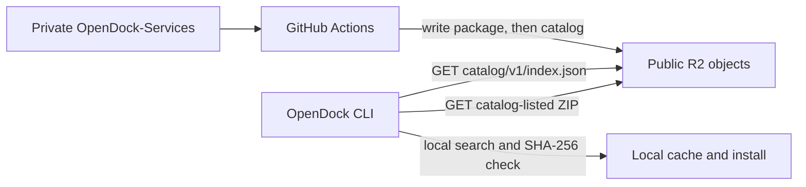

# OpenDock Product Architecture

> **Design baseline (2026-11-06).** This document records the greenfield
> product direction agreed for OpenDock. Existing CLI behavior and older
> design documents describe the current implementation and are reference
> material; they do not override these decisions. This design does not imply
> implementation or host validation.

## Product boundary

OpenDock has two independent repositories:

| Repository | Owns | Must not own |
| --- | --- | --- |
| `OpenDock` | Platform CLI, host bootstrap, shared runtime, configuration, generic service contract and catalog client | Names, configuration rules, or application logic for particular services |
| `OpenDock-Services` | Service integrations, descriptors, Compose/configuration files, capability handlers, docs, and release inputs | Platform implementation, customer runtime state, or private credentials |

There is **no bundled-service product category**. OpenDock ships the platform,
not a predetermined set of service applications. Every application is
discovered through the catalog and installed as a separate package. “Service”
is the one product term; publisher/source metadata may be added without
creating a Bundle/Extension classification.

The repositories are independent; no Git submodule is used. OpenDock does not
read the service repository at runtime. The platform must remain usable without
knowing service IDs. The first release defers paid access, accounts, purchase
entitlements, and license enforcement. Catalog entries and release artifacts
are publicly downloadable; the private GitHub repository remains the
maintainer source, not a customer access mechanism.

## User and operating model

- Linux is the first supported host target. macOS is second. Windows through
  WSL2 follows after those paths are understood and documented.
- Bootstrap handles host prerequisites and reports what it changed. Unsupported
  environments receive an explicit guide rather than a misleading success.
- The common CLI owns command grammar and orchestration. Service metadata and
  optional capabilities supply application-specific facts and procedures.
- The common path is zero-config where safe: infer machine-owned values,
  generate secrets, and perform declared prerequisites. Ask only for choices
  that cannot be inferred safely. Failed external publication is a partial
  state, not a successful public launch.

## Distribution and trust boundary

The canonical source is private `OpenDock-Services`; only CI gets access to
that repository. CI validates/packages releases, computes SHA-256 digests, and
publishes immutable versioned package objects plus a generated static JSON
catalog to Cloudflare R2. The OpenDock CLI and public catalog never access
private GitHub. No GitHub token is shipped to a user's machine.

The initial catalog is static JSON. The CLI performs search locally; no Worker
or search API is required. R2 has distinct development and production
environments. The CLI verifies a downloaded package's SHA-256 against the
catalog before extraction.

The client read path is direct HTTPS object download, not a request to an
OpenDock application API:

There is no per-request server lookup, authentication exchange, or runtime
connection to GitHub. R2 serves the static catalog and ZIP at the configured
public base URL. Here “no API” means no OpenDock API/Worker application; the
client still uses ordinary HTTPS GET requests to retrieve objects.

A checksum confirms that the package matches the catalog entry. It does **not**
prove publisher identity if an attacker can replace both package and catalog.
The first design accepts that limit to avoid signing-key management. CI-only
source access, restricted R2 publish credentials, protected release workflows,
HTTPS, and immutable versioned objects reduce operational risk but do not
provide cryptographic publisher authentication. Signatures may be added later.

Packages can contain executable capability code. Such code runs with the local
OpenDock user's privileges and is not sandboxed. The catalog is a curated
distribution channel, not a safe arbitrary third-party plugin loader.

See [`catalog-and-package-contract.md`](catalog-and-package-contract.md) for
the proposed catalog and artifact details.

## Service and site-instance model

Separate a service **package** from its running **instances**:

- Install a service package once per OpenDock host.
- Each deployment is a separate site instance. WordPress on `a.com` and
  WordPress on `b.com` have independent configuration, runtime resources, and
  user data.
- Any supported service may have instances on multiple domains. One registered
  base domain may also be shared by several service instances: for example,
  WordPress and n8n can both attach to `a.com` and receive distinct public
  hostnames. OpenDock owns the base-domain registry and checks route conflicts.
- Instance identity is a stable local ID, distinct from the human domain name.
  The first UX selects an instance by service plus base domain, while its
  internal ID keeps data and runtime resources stable if the domain changes.
- Initially, each service package has at most one instance per base domain,
  with one primary domain per instance. Several domain aliases to one instance
  are a later explicit feature, separate from multi-site support.

Configuration, secrets, Compose project identity, routes, and removal scope
are instance-scoped. Package upgrades preserve all instances. `purge` removes
one instance; package uninstall is allowed only after its instances are gone.

## Command direction

The CLI has four layers: host bootstrap; platform setup; service-package
discovery/install/upgrade; and site-instance lifecycle. A verb can have a
platform form and a service form: `opendock setup` configures platform-owned
settings, while `opendock setup wordpress --domain a.com` configures one
instance.

`launch <service> --domain <domain>` is a compound workflow over common unit
operations. It can complete missing safe setup and declared prerequisites,
start that instance, and publish its route when configured. It never installs
or upgrades package code implicitly. If external DNS/tunnel publication is
unavailable, report exactly what is running and what remains unpublished.

Proposed command meanings and sequencing are in
[`command-model.md`](command-model.md). `update` refreshes catalog metadata;
`upgrade` changes installed package versions.

## Service contract direction

Use declarative metadata wherever the platform can safely perform a common
operation. Add optional typed hooks only when correctness depends on
application knowledge. Hooks do not re-enter the CLI or bypass common
validation, dependency ordering, confirmation, routing, or errors.

Descriptor schema version and capability API version are independent. Reject
unsupported required versions before changing package or instance state. The
proposed contract is in [`service-contract.md`](service-contract.md).

## Decisions recorded

- Separate `OpenDock` and `OpenDock-Services` repositories; no submodule.
- Core does not know service-specific identities or behavior.
- No bundled-service category; all applications are catalog services.
- Defer paid/free policy and entitlements.
- Static JSON catalog; local CLI search.
- Cloudflare R2 for catalog and immutable packages, with dev/prod separated.
- SHA-256 package verification; signatures deferred with the limitation stated.
- One package can have multiple independent instances on different domains.
- Linux first, macOS second, WSL2 later.
- Existing code/docs are references, not backward-compatibility constraints.

## Design and delivery sequence

1. Finalize catalog, package layout, publication ordering, and checksum behavior.
2. Finalize descriptor schema, capability API, and compatibility checks.
3. Finalize command semantics and package/instance state model.
4. Specify Linux bootstrap and validate a clean-host service lifecycle.
5. Add macOS support; assess WSL2 after the primary paths.
6. Implement against the new contracts, then migrate a simple service before
   services requiring custom preparation or data migration.

The current checkout contains prior implementation experiments and a
substantial uncommitted migration. Inspect and classify that work against this
baseline before implementation; do not assume every existing change belongs
in the new design.

### Current implementation disposition

The feature branch already contains a repository-split experiment. The
following concepts are useful inputs, while their current file paths and exact
interfaces are not target contracts:

- **Carry forward conceptually:** descriptor-driven service discovery,
  optional typed service capabilities, common configuration/secret
  coordination, zero-config idempotent preparation, and explicit
  service-owned removal plans. Relevant references include
  `scripts/opendock_capabilities.py`, `scripts/opendock_catalog.py`, and
  `docs/command-architecture.md`.
- **Preserve as source/reference:** the ignored `archive/` copies and the
  service integration source in OpenDock-Services. Archive content is not
  runnable and must never be included in a package; it contains local config
  material that must remain private.
- **Redesign before reuse:** the current `services/bundles/` split, local
  `services/extensions/installed.toml` discovery, and package registry fields
  that require publisher-key signatures. The target has no bundle category,
  uses a static R2 catalog, and defers signatures.
- **Rebuild against the new contracts:** package install/upgrade activation,
  service discovery from downloaded releases, instance registry and
  per-instance Compose/configuration, base-domain-to-route mapping, and the
  `--domain` lifecycle commands. Current service paths and default-hostname
  assumptions do not model independent instances.
- **Keep configuration format undecided:** `opendock.toml` is proposed for the
  service descriptor. That does not decide whether private effective settings
  remain env files or use another format; Compose interpolation requirements
  and the earlier TOML discussion need a separate decision.

At the time this design baseline was recorded, no code or archive had been
removed as part of the design update. The implementation checkpoint below
records later work and verified outcomes.

## Implementation checkpoint

The first vertical distribution slice is now connected end to end through
package installation:

- OpenDock-Services published Uptime Kuma `0.1.0` to the dev R2 bucket through
  the tag-triggered GitHub Actions workflow. The source repository remains
  private; its CI workflow has the R2 write credentials.
- On the OpenDock checkout, the user ran `./dev_opendock update`,
  `./dev_opendock search uptime`, and `./dev_opendock install uptime-kuma`.
  The package installed under
  `services/extensions/uptime-kuma/releases/0.1.0`.
- The development wrapper selects the dev catalog, and the catalog URL is
  configured through the platform settings interface. A local
  `config/shared/cloudflare.toml` metadata error found during `update` was
  corrected by registering the skip key under its owning Cloudflare section.
- The installed release is discovered by `ServiceCatalog` through
  `services/extensions/installed.toml`. On the current checkout,
  `./opendock list services` lists Uptime Kuma and
  `./opendock check-config uptime-kuma` succeeds. The package setup flow also
  completed using the existing platform value and the package-declared
  `UPTIME_KUMA_SUBDOMAIN` default; it required no application infrastructure.
- Registry discovery now requires the registered service ID, versioned release
  path, and package descriptor version to agree, and rejects service IDs that
  collide with platform components. This keeps setup/config resolution bound to
  the package release that was installed.

This confirms catalog fetch, local search, checksum-verified download, package
discovery, config validation, and metadata-driven setup. It does **not** verify
service launch, readiness, upgrades, purge, domain-scoped instances, or
production publishing. Legacy service files remain in the OpenDock checkout
during the migration and are not the product model for new service work.
